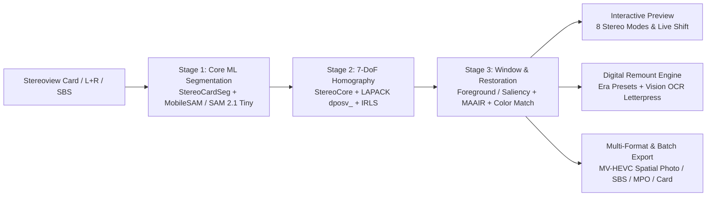

# ViewStereo 🎞️✨

**ViewStereo** is a professional macOS studio application for automatically detecting, geometrically rectifying, and restoring 19th-century historical stereoview cards (stereographs / stereo cards) and modern stereo photographs into pristine digital 3D media—including Apple Vision Pro Spatial Photos (MV-HEVC), Side-by-Side (SBS), Anaglyph, MPO, and digitally remounted archival stereoview cards.

> [!WARNING]
> **Early Development Status & User Participation / 開発初期段階のお知らせ**
> **ViewStereo** is currently under **active development** and in an **early stage of development** (現在開発中・特に開発初期段階). Users who download and use this application are participating in **improving the app's specifications and debugging** (アプリの仕様向上およびデバッグ作業へのご協力). Please expect potential instability, unexpected bugs, and breaking changes to features or UI as development evolves.

Designed as the archival restoration and geometric alignment companion to **SplatStereo**, **DepthStereo**, and **PanorStereo** in the **Stereo Creative Studio** family, **ViewStereo** combines Core ML segmentation (`StereoCardSeg` + `MobileSAM` / `SAM 2.1 Tiny`), 7-DoF symmetric homography optimization, intelligent stereo window placement, and historical digital remounting in a native Dark-First macOS workflow.

---

## 🚀 Key Features

### 🥽 v0.2.4 New: StereoStudioCore Engine Integration & Spatial Delivery Hub
- **StereoStudioCore Native Engine Unification**: Refactored monolithic DIBR, video depth, and multi-model AI pipelines to delegate directly to `StereoStudioCore` (`StudioVideoDepthSynthesizer`, `StudioMetalDIBR`, and `StudioVideoDepthSession`), slashing codebase footprint while enhancing parity and execution stability.
- **Unified Spatial Delivery Pipeline**: Integrated `SpatialDeliveryMenuButton` across photo and video master toolbars, enabling one-click spatial export into Apple Photos library (`PHPhotoLibrary`) and native macOS Share Sheet for instant Apple Vision Pro Spatial Media viewing.
- **Stereo Depth Budget Visual Metering**: Embedded `StereoDepthBudgetMeterView` in both Stereo Window (⌥⌘2) and AI 2D→3D (⌥⌘7) panels, displaying real-time near/far parallax percentages, window violation warnings, and 1-click auto-optimization.
- **Polished High-Contrast Mode Navigation**: Redesigned top workspace mode bar with deep contrast gradients, dynamic mode badges, and illuminated edge bars for effortless context switching between Stereo Archival Restoration and AI 2D→3D conversion.

### 🔄 v0.2.3: .vstereo Non-Destructive Sidecar, Studio Handoff & 3D Bakelite Icon
- **.vstereo Non-Destructive Hybrid Sidecar Storage**: Introduced `.vstereo` JSON sidecars (`StudioSidecarStore`) with `⌘S` shortcut. Seamlessly saves and restores alignment, stereo window shifts, card segmentation modes, and color settings alongside source files (or within fallback Application Support cache) without touching original media.
- **Cross-App Studio Handoff (`Send to Studio`)**: Deep integration with the StereoStudio suite. Export and handoff rectified stereoscopic images directly into **SplatStereo** (3DGS generation), **DepthStereo** (2.5D depth/spatial photos), and **PanorStereo** (360° VR) with zero-disparity plane alignment and automatic app launching.
- **Unified 3D Bakelite App Icon**: Upgraded app icons and welcome illustrations to the new 19th-century Amber Gold 3D Bakelite physical button aesthetic across all resolutions (16px to 1024px).

### 🏛️ v0.2.2: Deep Dome Arch Fitting & Keep Arch Precision Alignment
- **Deep Dome Arch Fitting & Superellipse Exponent Optimization**: Enhanced `StereoCardMountAnalyzer` with parametric deep dome arch curve modeling (supporting $r_y \le 0.45$ drop ratios, variable superellipse exponents $p \in [1.6, 2.6]$, and Sobel edge attraction scoring), accurately capturing steep-domed 19th-century stereoviews without truncating upper architectural motifs.
- **Shoulder Barrier Verification**: Introduced outer-connected mount barrier validation (`shoulderBarrierRatio` across 14% × 14% triangular corner zones) to safeguard rectangular/square cards from being falsely classified as arched frames.
- **Sub-Pixel Keep Arch Inner Mask Offset & Anti-Aliased Blending**: Re-engineered Keep Arch masking in both `StereoCardSegmenter` and `StereoCardMountRenderer` with sub-pixel margin insetting and smooth signed-distance normal blending (`printAlphaAt`), completely eliminating dark fringes, border bleed, and residual scanner artifacts.

### 📐 v0.2.1: 3-Stage Cascade Mount Analysis & Precision Crop Pipeline
- **3-Stage Cascade Mount Analyzer (`StereoCardMountAnalyzer`)**: Completely overhauled card segmentation with a 3-stage cascade pipeline—Stage 0 (outer-connected CIE Lab flood-fill scan margin removal, RANSAC deskewing, and drop-shadow crossing with 3-fold white-mount safety guards), Stage 1 (adaptive `step=1` rim sampling CIE Lab mount color barrier with outer-connected protection), and Stage 2 (SAT + Sobel coordinate-descent twin-window parametric fitting for `.square` / `.rounded` / `.arch` frames).
- **Dark-Background & Arch/Caption Overcrop Prevention**: Refined SAM 2.1 Tiny mask tolerance and candidate selection to prevent overcropping dark-background photographs (e.g., lunar/night scenes), fixed bottom caption trimmer false positives from dark rule streaks, and synchronized arch apex detection with Stage 2 window geometry.
- **Hardened Core ML PixelBuffer Input**: Switched `StereoCardSeg` and `SAM2_1TinyImageEncoder` inputs from `MLFeatureValue(cgImage:)` to direct `CVPixelBufferCreate` rendering, eliminating environment-dependent `Failed to create CVPixelBuffer` errors.

### 🛡️ v0.2.0: Symmetrical Localization, Memory Hardening & Crash Prevention
- **100% Symmetrical English & Japanese Localization**: Completely eliminated hardcoded strings across advisory banners, interactive tooltips, and welcome guide cards. All 493 localization keys are synchronized with zero parity gaps.
- **Hardened State Transitions & Memory Management**: Fixed state persistence bugs where manual swaps (`X`) or single-eye depth modes leaked into subsequent images. Introduced proactive buffer reclamation (`clearDepthSynthesisCache` / `clearStaticImageBuffers`) to eliminate memory growth during extended sessions and batch jobs.
- **Robustness & Crash Elimination**: Added strict range bounds checking in `StereoCardSegmenter` corner detection and border sampling, permanently resolving edge-case fatal errors on unusual card aspect ratios and small crops.
- **Unified Shortcut Navigation**: Added `Toggle Batch Processing Panel` (`⌥⌘6`) under the Panels menu, fully synchronizing the inspector's batch section expansion state with keyboard shortcuts and menu items.

### 🎬 v0.1.9 New: Video 2D-to-3D Conversion & Spatial Video (MV-HEVC) Pipeline
- **Video 2D-to-3D Conversion for Spatial Media**: Transform 2D videos (`.mp4`, `.mov`, `.m4v`) into Apple Vision Pro-ready Spatial Video (MV-HEVC `.mov` with spatial metadata), Full/Half SBS 3D, and Dubois Anaglyph 3D video.
- **Stateful Video Depth Inference via Apple Depth Pro 2**: Leverages Core ML `MLState` (macOS 15+) for cross-frame hidden state propagation, automatic scene cut detection with blackout recovery, temporal EMA smoothing, and depth range locking to eliminate depth flickering.
- **Metal GPU-Accelerated DIBR & Optimized AVFoundation Engine**: Integrates Metal compute shader zero-copy warping, auto-rotation handling (`preferredTransform`), SDR Rec.709 tone mapping, `CVPixelBufferPool` buffer recycling, AAC 256kbps audio re-encoding, and pre-export disk space validation.
- **SBS 3D Video Salvage & Re-synthesis**: Extract single-eye video streams (Left or Right) from existing SBS 3D footage and re-synthesize violation-free, comfortable 3D stereoscopic videos within Percival's zone.

### 🪟 v0.1.8 New: Intelligent DIBR Stereo Window Optimization & High-Res 2D-to-3D Export
- **Intelligent Zero-Parallax Plane Alignment for 2D-to-3D Synthesis**: Coupled depth disparity distributions and Apple Vision Attention Saliency into `computeDepthWindowSetup`, automatically setting the optimal zero-parallax focal plane (`focusRatio`) to structurally eliminate frame-edge stereoscopic window violations while maintaining natural Percival comfort-zone depth.
- **High-Resolution Export & Batch 2D-to-3D Synthesis**: Introduced full-resolution synthesis caching (`cachedSynthFullLeftRGB`/`RightRGB`), ensuring flawless Spatial Photo, SBS, and Anaglyph exports with dynamic zero-parallax window placement during both single-item and folder batch runs.
- **Unified Normalized Disparity Sampling**: Standardized bilinear disparity map sampling with gamma and contrast curve transformations across preview warping, interactive parameter adjustments, and offline rendering.

### 🗂️ v0.1.7: 3-Pane Studio Workflow & 9-Engine AI Depth Model Manager
- **3-Pane Studio Workspace & Tree-Style File Browser**: Redesigned workflow around a workspace directory with a persistent left tree browser (`⌥⌘L`). Features initial launch folder selection sheet (`NSOpenPanel`), automatic L/R pair grouping (`_L`/`_R`, `-L`/`-R`), per-item processing status badges (`✓`/`⚠️`/`✕`), and output directory protection (`ViewStereo_Output`).
- **AI Depth Model Manager (StereoStudioCore Integration)**: Unified model management supporting 9 Core ML depth engines—Apple Depth Pro, Depth Pro 2 (Small/Base/Large), Depth Anything V2/V3, and MoGe-2 (ViT-B/L). Features on-demand Hugging Face downloading directly within Preferences and zero-duplicate shared model storage across the Stereo Studio app family.
- **Production-Grade Single-Eye Depth 3D Salvage**: Fully wired the Single-Eye Depth 3D pipeline to the user's preferred Core ML depth engine, delivering pristine 2D-to-3D stereoscopic conversion with automatic peak memory reclamation.

### 🛟 v0.1.6: Single-Eye Depth 3D Salvage & Anomaly Diagnostics
- **Automated Stereoscopic Anomaly Diagnostics**: Automatically diagnoses mismatched pairs (different takes/misplaced prints), unilateral damage/scratches, and excessive stereoscopic disparity during 7-DoF alignment.
- **Human-in-the-Loop Single-Eye Depth 3D Salvage**: Provides 1-click action buttons directly under the status alert banner to convert the undamaged left or right image into a pristine AI Depth 3D stereo pair, complete with smart recommendation hints (✨ Recommended) based on defect rates and sharpness scores.
- **Stereo Source Controls in Stereo Window (⌥⌘2)**: Adds persistent Stereo Source selection (Original L+R / Left Depth 3D / Right Depth 3D), virtual stereo base slider (0.5% - 6.0%), and depth curve gamma controls for real-time 60fps adjustment.
- **Top-Edge Gradient Protection & Overcrop Recovery**: Enhances `StereoCardSegmenter` with sky/mountain gradient safety guards and top-border recovery to eliminate edge clipping on bright horizon prints.

### 🔄 v0.1.5: Pseudoscopic Stereo Auto-Swap & Enhanced SAM 2.1 Tiny
- **Intelligent Pseudoscopic (Reversed L/R) Detection & Auto-Swap**: Automatically detects reversed stereoscopic pairs (cross-eyed cards, mislabeled scans, inverted depth cues) upon ingestion. Safely auto-swaps to orthoscopic stereo with instant telemetry alerts (`⚠️ Reversed (Swapped)` / `⚠️ Reversed (Pseudoscopic)`), togglable in Preferences.
- **Dynamic Stereo Window Recalculation on Manual Swap (`X`)**: Instantly recomputes foreground disparities and optimal window positioning when toggling `X` to eliminate window violation risks caused by disparity sign reversal.
- **Refined SAM 2.1 Tiny Upper-Boundary Prompting**: Elevated the upper prompt point to `bh * 0.10` and implemented U-Net expected-height arbitration to prevent clipped top borders and false exclusions.
- **Batch Processing State Isolation**: Guarantees independent auto-swap evaluation per image without leaking swap state across batch runs.

### 🎛️ v0.1.4: Workflow Palette Architecture & Corner Segmentation Engine
- **Optimized Right Inspector Hierarchy**: Placed **Basic Settings (Auto Recipe)** at the very top of the inspector panel. By default on startup / standby drop mode, only Basic Settings is expanded while downstream adjustment panels remain collapsed, establishing a clean, logical workflow order.
- **Top-Down Shortcut & Toolbar Alignment**: Keyboard shortcuts (⌥⌘1: Recipe, ⌥⌘2: Window, ⌥⌘3: Mount, ⌥⌘4: Restore, ⌥⌘5: Colorize, ⌥⌘6: Batch) and toolbar icons now strictly mirror the vertical palette structure.
- **Multi-Corner Independent Geometric Measurement**: Upgraded `StereoCardSegmenter` to independently measure and determine square, rounded, and arched corners from background corner samples (supporting white/black backings), with full-healing protection for notch numbering and historic imprints.
- **Integrated Standby Hero Background**: Integrated high-resolution archival sample hero artwork for initial drop guidance.

### 🎨 v0.1.3: AI Colorization & Hand-Tint Harmonization (`StereoColorizer`)
- **On-Device AI & Hand-Tint Colorization**: Bundled `StereoColorizer.mlmodelc` transforms monochrome stereoviews into **Natural Full Color (AI)** or **1890s Hand-Tinted (Watercolor)** prints, or **Harmonizes Existing Hand-Tint** across left and right views.
- **Streamlined Toolbar & SAM 2.1 Tiny Pipeline**: Added dedicated toolbar toggles for Restore, Colorize, Window, Mount, Recipe, and Batch panels, and standardized segmentation on `StereoCardSeg + SAM 2.1 Tiny`.

### 🎞️ v0.1.2 New: Vintage Photo Restoration & Core ML AI Optical Deblur
- **Vintage Print Tone & Contrast Recovery**: Non-destructive 1860s Albumen Sepia, 1890s Warm Silver, and Pure Monochrome tone presets paired with Auto-Level (B/W Point) and Local Contrast (CLAHE) restoration plus a real-time **Compare Before** toggle.
- **On-Device NAFNet-GoPro Optical Deblur**: Bundled `NAFNetDeblur.mlmodelc` restores lens softness and archival edge detail 100% offline, with **Foliage / Texture Protection** to prevent stereoscopic retinal rivalry.

### ✨ v0.1.1 Enhancements: Full-Composition Remount & StereoView Workflow
- **100% Aspect Ratio Preservation on Card Remount**: Uses Aspect Fit bilinear resampling with symmetric slot centering so remounted stereoview cards preserve the exact full-frame composition of the aligned SBS view, plus automatic joined-gap detection for gapless source cards.
- **Refined Arch-Top Shift Bounds & Shortcuts**: Caps horizontal window shift to prevent arch-top clipping (`2.0%` auto / `3.5%` manual limit) and promotes `StereoView` card display to `⌘1` (with `2D` at `⌘8`).

### 🧩 Core ML Stereoview Card Segmentation
- **Automatic Card & Arch-Top Detection**: Drop scanned 19th-century stereoview cards directly onto the canvas. `StereoCardSeg` (U-Net) paired with selectable **MobileSAM** or **SAM 2.1 Tiny** refinement accurately isolates left/right photographic prints and authentic arch-top frames.
- **Flexible Extraction Modes**: Choose between **Crop Inner** (clean rectangular extraction), **Keep Arch (Black)** (preserving original arched borders), or **Off** (for modern L/R pairs and SBS images).

### 📐 7-DoF Symmetric Homography & MAAIR Crop
- **Zero Vertical Disparity**: Powered by `StereoCore` and Apple Accelerate LAPACK (`dposv_` + IRLS robust optimization), ViewStereo resolves hand-mounted print rotation, scale differences, horizontal/vertical keystoning, and vertical disparity down to sub-pixel precision.
- **Vision Person Motion Mask**: Optional Cha-Cha stereo support that masks moving human subjects during alignment.
- **MAAIR (Maximum Area Axis-aligned Inscribed Rectangle)**: Automatically computes and crops to the largest valid common rectangle with zero black borders, with an optional aspect-ratio lock.

### 🪟 Intelligent Stereo Window & Saliency Alignment
- **Window Violation Prevention**: Automatically calculates optimal horizontal stereo window shift based on the nearest foreground subject—with optional **Vision Attention Saliency** prioritization—to eliminate retinal rivalry and uncomfortable frame-edge violations.
- **Real-Time Fine-Tuning**: Precision 3-piece studio controls (slider, reset, numeric input) for manual stereo window calibration.

### 🏛️ Digital Remount & Letterpress OCR Typography
- **8 Era-Authentic Mount Presets**: Reconstruct damaged or cropped stereoviews onto historically accurate mounts: *Original Mount (Remount)*, *Auto Sample Source Color*, *1900s Keystone Dark*, *1880s Classic Buff*, *1870s Cabinet Terracotta*, *1870s Victorian Green*, *1860s Chrome Yellow*, and *1850s Early Ivory*.
- **Authentic Physical Details**: Supports 7-inch standard card specs (*Standard 7×3.5 in*, *Cabinet 7×4.0 in*, *Imperial 7×4.5 in*), curved mount shading, 1870s bicolor edges, print cut styles (*Arched Top*, *Rounded Corners*, *Square*), and center division styles.
- **Vision OCR Letterpress**: Automatically reads titles, catalog numbers, and vertical side-margin publisher imprints from original cards and re-typesets them onto the remounted card.

### 🎨 Vintage Restoration & Multi-Format Export
- **Color Harmonization & Dust Removal**: Automatic Left/Right exposure and color matching (`Match to Left` / `Match to Right`) plus unilateral dust and scratch suppression.
- **8 Real-Time Display Modes**: `2D`, `SBS`, `LR/RL`, `Dubois`, `Color Anaglyph`, `Gray Anaglyph`, `Polarized`, and `Stereoview Card`.
- **11 Export Layouts**: Export to `Spatial Photo (HEIC / MV-HEVC)`, `MPO (3D Camera)`, `Separate L/R`, `Stereoview Card`, `SBS`, `LR/RL (4-Way)`, `Dubois`, `Color Anaglyph`, `Gray Anaglyph`, `Polarized`, and `2D` (JPEG/PNG).
- **Batch Folder Processing**: Process entire archives of stereoview cards or L/R pairs automatically (`Auto`, `SBS Only`, `Consecutive L/R Pairs`) with optional adjustment reports (`.txt`).

---

## 🛠️ Architecture

---

## 📦 System Requirements

- **Operating System**: macOS 14.0 (Sonoma) or macOS 15.0+ (Sequoia)
- **Hardware**: Apple Silicon Mac (M1 / M2 / M3 / M4, Pro / Max / Ultra) recommended
- **Memory**: 8 GB RAM minimum (16 GB+ recommended for high-resolution 4K–8K archival scans and batch processing)

---

## 🚀 Getting Started

1. **Launch ViewStereo**: Open `ViewStereo.app`.
2. **Import**: Drag and drop a scanned stereoview card, a pair of Left/Right images, a Side-by-Side (SBS) image, or an entire folder for batch processing.
3. **Auto Align & Window**: ViewStereo automatically segments the card, rectifies 7-DoF geometry, matches colors, and sets an optimal stereo window.
4. **Fine-Tune or Remount**: Adjust the Stereo Window shift if desired, or switch to **Card** view (`⌘8`) to customize Digital Remount presets and OCR typography.
5. **Export**: Export directly to Apple Vision Pro **Spatial Photo (HEIC)**, **SBS**, **Anaglyph**, **MPO**, or a restored **Stereoview Card** (`⌘E`).

---

## 📖 Documentation & Support

- [**Official Website**](https://viewstereo.p-media.jp/)
- [**Online Documentation (日本語)**](https://viewstereo.p-media.jp/docs.html)
- [**Online Documentation (English)**](https://viewstereo.p-media.jp/docs_en.html)
- [**User Manual (Markdown - 日本語)**](docs/manual_ja.md)
- [**Technical Specification**](docs/specification.md)
- [**Third-Party Notices**](THIRD_PARTY_NOTICES.md)

---

## 🎨 Stereo Creative Studio Series

ViewStereo shares the Dark-First studio design DNA and `StereoStudioCore` architecture with the Stereo Creative Studio Trilogy:

| Studio | Theme Color | Focus & Pipeline | Official Website |
| :--- | :--- | :--- | :--- |
| **SplatStereo** | 🔴 Red | 3D Gaussian Splatting & Free-viewpoint Synthesis | [https://splatstereo.p-media.jp/](https://splatstereo.p-media.jp/) |
| **DepthStereo** | 🟢 Green | 2.5D Monocular AI Metric Depth & Spatial Video | [https://depthstereo.p-media.jp/](https://depthstereo.p-media.jp/) |
| **PanorStereo** | ⚪️ White | 360° Equirectangular Panoramic AI Depth & ODS Stereo | [https://panorstereo.p-media.jp/](https://panorstereo.p-media.jp/) |
| **ViewStereo** | 🟠 Amber Gold | 19th-Century Stereoview Restoration, 7-DoF Alignment & Remount | [https://viewstereo.p-media.jp/](https://viewstereo.p-media.jp/) |

---

## 🤝 License

© 2026 ViewStereo Project. All rights reserved.
Inspired by 19th-century stereoview craftsmanship and modern computational stereoscopy.
