# ViewStereo 包括的技術・機能詳説レポート（全貌解説書）

---

## 1. エグゼクティブ・サマリー

**ViewStereo（ビューステレオ）** は、19世紀の歴史的ステレオ写真・ステレオカード（Stereoview / Stereograph）のデジタル復元・保存・近代化、および現代の2D/3D写真・動画を Apple Vision Pro（空間写真・空間ビデオ）等の最先端立体視環境へ昇華させるために開発された、macOS ネイティブのプロフェッショナル・ステレオスタジオアプリケーションです。

従来のステレオ写真復元や3D変換は、手作業による煩雑な位置合わせ（回転・スケール・垂直視差の修正）、経験に頼ったステレオウィンドウ調整、退色や傷のレタッチなど、高度な専門技能と多大な時間を要していました。ViewStereo は、**最先端の機械学習（Core ML / SAM 2.1 / Apple Depth Pro 2 / NAFNet / StereoColorizer）**、**数理幾何最適化（Apple Accelerate LAPACK 7-DoF 対称ホモグラフィ + IRLS）**、および **Metal GPU 高速化 DIBR（Depth-Image-Based Rendering）** を統合。台紙付きステレオカードや単眼動画をドロップするだけで、完全自動で検出・整準・ウィンドウ最適化・復元・3D変換を行い、Apple Vision Pro 互換の空間写真・空間ビデオや各種 3D フォーマットへ出力するエンドツーエンドのパイプラインを実現しています。

また、本作は「Stereo Studio シリーズ」（単眼深度3D変換の **DepthStereo**、360度パノラマ立体化の **PanorStereo**、3Dガウシアンスプラッティング連携の **SplatStereo**）の中核として、共通基盤ライブラリ **StereoStudioCore** を介してモデルやコンポーネントを相互共有するエコシステムを形成しています。

---

## 2. システムアーキテクチャ & テクノロジースタック

ViewStereo は Apple Silicon（M1/M2/M3/M4）のニューラルエンジン（ANE）および GPU を極限まで引き出すようネイティブ設計されています。

```mermaid
flowchart TD
    subgraph Input ["入力ソース"]
        A1["19世紀ステレオカードスキャン"]
        A2["左右ペア画像 / SBS画像"]
        A3["単眼 2D 静止画"]
        A4["2D 動画 (.mp4 / .mov)"]
    end

    subgraph CoreML ["Core ML / Vision パイプライン"]
        B1["StereoCardSeg U-Net<br/>+ SAM 2.1 Tiny<br/>(台紙・写真領域自動分割)"]
        B2["NAFNet-GoPro<br/>(AI 光学デブラー)"]
        B3["StereoColorizer<br/>(明治手彩色 / AIカラー化)"]
        B4["Apple Depth Pro 2<br/>Stateful MLState<br/>(高精度時間安定深度推論)"]
    end

    subgraph MathGeometry ["数理幾何 & 視覚工学エンジン"]
        C1["7-DoF 対称ホモグラフィ<br/>(Accelerate LAPACK dposv_ + IRLS)"]
        C2["MAAIR 最大面積軸平行内接矩形<br/>(黒枠なし自動クロップ)"]
        C3["インテリジェント・ステレオウィンドウ<br/>(最前景 & Vision 顕著性解析)"]
        C4["ステレオ異常・偽視自動診断<br/>(Pseudoscopic / Mismatch / Damage)"]
    end

    subgraph RenderGPU ["GPU / レンダリング & AVFoundation"]
        D1["ViewStereoMetalDIBR<br/>(Metal Compute Shader ゼロコピー立体合成)"]
        D2["時代別デジタル・リマウント<br/>(8種台紙・活版OCRタイポグラフィ)"]
        D3["AVAssetWriter / CVPixelBufferPool<br/>(空間ビデオ MV-HEVC 高速生成)"]
    end

    subgraph Output ["出力フォーマット"]
        E1["Apple Vision Pro 空間写真 (Spatial Photo HEIC)"]
        E2["Apple Vision Pro 空間ビデオ (MV-HEVC .mov)"]
        E3["Side-by-Side (Full / Half SBS)"]
        E4["Dubois / カラー / グレースケール アナグリフ"]
        E5["Stereoview Card (高精細デジタル台紙再構成)"]
        E6["MPO / 左右分離 (Separate L/R)"]
    end

    Input --> CoreML
    CoreML --> MathGeometry
    MathGeometry --> RenderGPU
    RenderGPU --> Output
```



### 主要技術スタック
- **プラットフォーム**: macOS 14.0 (Sonoma) 以降（macOS 15 Sequoia の `MLState` 最適化対応）
- **言語 & フレームワーク**: Swift 6, SwiftUI, AppKit, Metal, Core ML, Vision, Accelerate (LAPACK/BLAS), AVFoundation, Core Image, Core Video
- **AI / 機械学習モデル群**:
  - `StereoCardSeg.mlpackage`: ステレオカード台紙と左右印画紙のセグメンテーション（U-Net）
  - `SAM 2.1 Tiny (Image/Prompt/Mask)`: Segment Anything 2.1 によるミリ単位の境界追跡
  - `NAFNetDeblur.mlpackage`: 古写真・歴史的レンズぼけ復元用光学デブラー
  - `StereoColorizer.mlpackage`: 明治手彩色（透明水彩調）および AI 自然彩色
  - `Apple Depth Pro 2 / Depth Pro`: 単眼深度推定（macOS 15+ Core ML MLState による前フレーム隠れ状態保持）
  - 全9種深度モデル（Depth Anything V2/V3, MoGe-2 等）へのオンデマンド切替対応
- **数理最適化**:
  - Apple Accelerate LAPACK `dposv_`（コレスキー分解）による対称ホモグラフィ求解
  - IRLS（反復再加重最小二乗法）による外れ値除去
  - MAAIR（Maximum Area Axis-aligned Inscribed Rectangle）アルゴリズム

---

## 3. コア機能と革新的パイプライン詳説

### 3.1. Core ML ステレオカード自動検出・分割 (Card Segmentation)
台紙付きでスキャンされた19世紀のステレオカード（立体写真）を読み込むと、AI が台紙、左写真、右写真、およびアーチ型（Arch-top）枠を自動識別します。
- **2段階ハイブリッドセグメンテーション**:
  - 高速な軽量 U-Net（`StereoCardSeg`）でおおまかな左右領域とアーチ境界を予測。
  - `SAM 2.1 Tiny`（Encoder/Prompt/Decoder）により、経年劣化で変色した台紙やかすれた印画紙境界をサブピクセル精度でトレース。
- **抽出モード（Card Mode）**:
  - `Crop Inner`: 台紙およびアーチ枠の内側のみを最大矩形として抽出。
  - `Keep Arch (Black)`: 歴史的なアーチ型フレームの形状を保ち、外側を黒塗りして保持。
  - `Off`: 自動分割を行わず、入力画像全体を通常の SBS または左右ペアとして処理。
- **上端過剰クロップ防止機構（Top-Edge Recovery）**:
  - 空やグラデーションが台紙の余白と誤認され、富士山の山頂や天井が切り落とされる現象を防ぐため、水平トリミング後に写真上部を再サンプリングして保護するセーフティガード（`recoverOvercroppedTopEdgeRGB`）を搭載。

---

### 3.2. 7自由度（7-DoF）対称ホモグラフィ幾何整準 & MAAIR クロップ
19世紀のステレオカードは、2枚の印画紙を手作業で台紙に糊付けしていたため、左右で回転ズレ、上下ズレ（垂直視差）、拡大縮小差、台形歪み（キーストーン）が必ず生じています。これらは鑑賞者の脳に激しい眼精疲労（眼痛）を引き起こします。
- **7-DoF 対称ホモグラフィ補正**:
  - 画像特徴点マッチングから、Apple Accelerate LAPACK `dposv_` を用いて左右対称な射影変換行列（7自由度：X/Y平行移動、回転、等方スケール、垂直シア、台形歪み）を導出。
  - IRLS（Iteratively Reweighted Least Squares）により、レンズゴミや傷などの外れ値の影響を排除し、垂直視差 0.5px 以下の完全なエピポーラ幾何を構築。
- **MAAIR（最大面積軸平行内接矩形）**:
  - ホモグラフィ変換によって生じる画像の傾きや歪みに対し、黒枠を一切残さずに有効画素領域を最大化する内接矩形を自動計算。アスペクト比維持オプションにも対応。
- **人物モーションマスク（Cha-Cha 撮影対応）**:
  - 単眼カメラで左右に体を揺らして撮る「チャチャ（Cha-Cha）撮影」において、風で揺れる木々や歩行者を Vision フレームワークで検出し、幾何整準計算の重みから除外。

---

### 3.3. インテリジェント・ステレオウィンドウ最適化
立体視において最も重要な「ステレオウィンドウ（画面枠の奥行き位置）」を自動決定します。
- **エッジ飛び出し（Window Violation）の撲滅**:
  - 被写体が画面枠より手前に飛び出している状態で画面端に触れると、視覚的矛盾（網膜闘争）が起きて脳が疲労します。
  - ViewStereo は、全画素の視差分布ヒストグラムと Apple Vision 顕著性解析（Attention Saliency）を統合し、「画面内で最も手前にある注視被写体」が画面枠より奥、あるいは枠と同一平面（ゼロ視差面）になるよう水平シフト（`focusRatio`）を自動算出。
  - 視覚的快適帯域（**パーシバル快適域：視差約3.0%以内**）に自然に収めます。
- **3点セットUI**:
  - スライダー、リセットボタン、数値直接入力フィールドを連動させ、1画素単位の直感的な微調整が可能。

---

### 3.4. 偽視・ステレオ異常自動診断 & 単眼救済（Single-Eye Depth 3D Salvage）
- **左右逆（偽視 / Pseudoscopic Stereo）の自動検出 & スワップ**:
  - 交差法用の画像や、スキャン時に左右が入れ替わったデータを読み込んだ際、奥行きの前後が反転していることを自動認識。自動的に左右画像を入れ替えて正常な立体視に復元。
- **3大ステレオ異常診断**:
  - `stereoMismatch`（左右の撮影時期や構図が異なる別テイク・不一致）
  - `unilateralDamage`（片側印画紙の大面積な剥がれ・破損）
  - `excessiveDisparity`（ステレオベースが広すぎて人間の眼では立体融合できない）
- **単眼救済（Single-Eye Depth 3D Salvage）**:
  - 片側が破損していたり立体視が破綻している場合、損傷率や鮮鋭度から「✨ 推奨（Recommended）」な眼を自動判定。
  - ユーザーがワンクリックで健全な方の眼を選択し、AI 深度モデルによる高品位な 2D→3D 変換を行って完全な立体写真として蘇らせます。

---

### 3.5. 動画 2D→3D 変換 & 空間ビデオ（MV-HEVC）生成（v0.1.9 新機能）
静止画にとどまらず、一般的な 2D 動画（.mp4 / .mov / .m4v）を Apple Vision Pro 向けの高品質な「空間ビデオ」へ一括変換する機能を搭載しました。

```
2D動画入力 ──> シーンカット検出 ──> Apple Depth Pro 2 (Stateful MLState) ──> Metal DIBR (GPU) ──> MV-HEVC 空間ビデオ
               (暗転復帰/EMA)      (フリッカー完全撲滅/隠れ状態保持)         (ゼロコピー合成)      (.mov / SBS / アナグリフ)
```

- **Apple Depth Pro 2 Stateful 深度推論（macOS 15+ Core ML MLState）**:
  - 従来の単眼動画 3D 化で最大の課題だった「フレームごとの深度チラつき（フリッカー）」を、前フレームの隠れ状態（Hidden State）をテンソルとして引き継ぐ `MLState` 機構により根本的に解決。
  - 時間的平滑化（EMA: 指数移動平均）および奥行きレンジ固定（Lock Depth Range）を併用し、映画のような滑らかな立体深度を実現。
  - シーンチェンジ時にはクールダウン付きの自動シーンカット検出が働き、前シーンの残像影響を遮断。
- **Metal GPU 高速化 DIBR（ViewStereoMetalDIBR）**:
  - ピクセルごとの視差マッピングとオクルージョン（遮蔽境界）補間を Metal コンピュートシェーダーで GPU ゼロコピー実行。リアルタイムに近い驚異的な処理速度を実現。
- **プロ仕様の AVFoundation パイプライン**:
  - 自動正立化（`preferredTransform`）、SDR Rec.709 トーンマッピング、`CVPixelBufferPool` メモリ再利用、AAC 256kbps 高音質オーディオ再多重化。
  - 書き出し前のディスク空き容量チェックとセーフティ警告。

---

### 3.6. ヴィンテージ古写真修復 & 手彩色・AI カラー化
- **退色階調復元（Vintage Photo Restoration）**:
  - 1860年代の「鶏卵紙（Albumen Sepia）」、1890年代のゼラチンシルバー調「ウォームシルバー（Warm Silver）」、純モノクロームの階調トーンプリセット。
  - 自動黒締め・白抜き（Auto-Level B/W Point）および局所コントラスト適応（CLAHE）により、眠くなった古写真の陰影と質感を立体的に再興。
- **Core ML AI 光学デブラー（NAFNet-GoPro）**:
  - 19世紀のレンズの甘さや経年によるぼけを、ニューラルネットワークでくっきり鮮鋭化。左右眼のテクスチャ差で生じる視野闘争（Retinal Rivalry）を防ぐ高周波・テクスチャ保護スライダーを搭載。
- **片側ノイズ・ダスト自動除去 & 左右カラーマッチング**:
  - 片方の印画紙だけに付着したゴミや白抜け傷を反対側の正常なテクスチャから補正。左右の露光ムラも自動均一化。
- **手彩色風・AI カラー化（StereoColorizer）**:
  - モノクロ写真を、明治時代に輸出用として職人が彩色した「横浜写真」風の透明水彩画調（Hand-Tinted）に染め上げる専用 Core ML モデルを内蔵。
  - 明治手彩色調、AI ナチュラルカラー化、既存手彩色の左右色ムラ同期の3モードに対応。

---

### 3.7. 時代別デジタル・リマウント & 活版 OCR タイポグラフィ
修復した左右写真を、当時の美しい台紙に再レイアウト（デジタル・リマウント）して鑑賞・保存できます。
- **8種類の時代別台紙プリセット**:
  - 1850s Early Ivory（初期アイボリー）
  - 1860s Square Yellow（角丸なしイエロー台紙）
  - 1870s Round Yellow（丸角イエロー台紙）
  - 1880s Cabinet Orange（キャビネット判オレンジ）
  - 1890s Keystone Gray（キーストン社調グレー）
  - 1900s Keystone Dark（暗色厚紙台紙）
  - Modern White / Modern Dark（現代写真向け）
- **高精度ディテール**:
  - 7インチ標準規格（Standard / Cabinet / Imperial）、時代考証に基づいたバイカラー縁取り、湾曲レンズによる立体感を演出する曲面マウントシェーディング。
- **Vision OCR 活版印刷タイポグラフィ**:
  - Apple Vision OCR が元のスキャン台紙から「整理番号」「タイトル」「左右余白の版元クレジット（Underwood & Underwood, Keystone View Co. 等）」を自動抽出し、クラシックな活版印刷風フォントで台紙上に美しく再印字。

---

### 3.8. スタジオ型 UI とバッチ処理エコシステム
- **3ペイン・スタジオ型ファイルブラウザ（v0.1.7）**:
  - **左ペイン**: 作業フォルダ内のツリー型ファイルブラウザ（`⌥⌘L`）。ファイル名規則（`_L`/`_R` 等）による左右ペアの自動統合、処理ステータスバッジ（✓完了、⚠️警告、✕失敗）を表示。
  - **中央ペイン**: 8種のリアルタイム立体視プレビュー（StereoView, SBS, LR/RL, Dubois アナグリフ, Color/Gray アナグリフ, 偏光方式, 2D）。
  - **右ペイン**: ツールパレット（`⌥⌘1`〜`⌥⌘6`）。基本レシピ、ウィンドウ、台紙、階調復元、カラー化、バッチ処理を整然と整理。
- **多彩な書き出し（11種類）**:
  - `Spatial Photo (HEIC / MV-HEVC)`（Apple Vision Pro 空間写真）
  - `Spatial Video (MV-HEVC .mov)`（Apple Vision Pro 空間ビデオ）
  - `Full SBS` / `Half SBS`
  - `Dubois Anaglyph` / `Color Anaglyph` / `Gray Anaglyph`
  - `Stereoview Card`（完成台紙）
  - `MPO`（マルチピクチャーオブジェクト）
  - `Separate L/R`（左右個別画像）
- **複数一括バッチ処理**:
  - フォルダ内の大量のカードスキャンやペア画像を無人バックグラウンド処理。自動調整のパラメータや判定結果を記録した `.txt` レポートを同時出力。

---

## 4. バージョン変遷と進化の軌跡（v0.1.0 〜 v0.2.1）

わずか数週間の間に、驚異的なペースで機能の洗練と拡張が行われています。

| バージョン | リリース日 | 主なマイルストーン・革新点 |
| :--- | :---: | :--- |
| **v0.1.0** | 2026.11.18 | **初回正式リリース**。Core ML カード自動分割（U-Net + SAM）、7-DoF 対称ホモグラフィ幾何整準、MAAIR クロップ、インテリジェント・ステレオウィンドウ、8種時代別デジタル台紙、活版 OCR、Spatial Photo 書き出し。 |
| **v0.1.1** | 2026.11.18 | デジタル・リマウントのアスペクト比100%維持（Aspect Fit刷新）、アーチ保持時の水平シフト上限最適化、ショートカット整理。 |
| **v0.1.2** | 2026.11.19 | **古写真・退色階調復元**（鶏卵紙/ゼラチンシルバー調、CLAHE）新設。**Core ML AI 光学デブラー（NAFNet-GoPro）** 搭載。片側ノイズ・ダスト即時非破壊除去。 |
| **v0.1.3** | 2026.11.20 | **手彩色風・AI カラー化（StereoColorizer）** 搭載（明治手彩色透明水彩調）。SAM 2.1 Tiny 一本化。ツールバー刷新。 |
| **v0.1.4** | 2026.11.20 | 右インスペクターパレット再設計（基本レシピ最上段配置）。4隅丸角・アーチの上下独立判定とコーナー保護ヒーリング。 |
| **v0.1.5** | 2026.11.21 | **左右逆（偽視 / Pseudoscopic Stereo）の自動検出＆自動スワップ**。Xキー反転時のウィンドウ即時追従。 |
| **v0.1.6** | 2026.11.22 | **ステレオ異常自動診断 ＆ ユーザー主導型片側救済（Single-Eye Depth 3D Salvage）**。台紙セグメンテーションの上端過剰クロップ防止セーフティガード（富士山頂・青空保護）。 |
| **v0.1.7** | 2026.11.22 | **3ペイン・スタジオ型ファイルブラウザ**（ツリーブラウザ・L/Rペア自動統合・ステータスバッジ）。**全9種 Core ML 深度モデルマネージャー**（Hugging Face ダウンロード・StereoStudioCore モデルフォルダ共有）。 |
| **v0.1.8** | 2026.11.23 | **DIBR 2D-3D 合成のステレオウィンドウ自動最適化**（エッジ飛び出し防止・パーシバル快適域ロック）。フル解像度キャッシュ管理刷新。 |
| **v0.1.9** | 2026.11.23 | **動画 2D→3D 変換＆空間ビデオ（MV-HEVC）生成機能を新搭載**。**Apple Depth Pro 2 Stateful 深度推論**（macOS 15+ Core ML MLState によるフリッカー撲滅）。**Metal GPU 高速化 DIBR**。 |
| **v0.2.0** | 2026.11.24 | **日英ローカライズ100%対称化**（全493キー完全一致）。状態遷移・キャッシュ即時解放によるメモリリーク根絶。台紙抽出の境界ガード強化。`⌥⌘6` ショートカット統一。 |
| **v0.2.1** | 2026.11.24 | **3段階カスケード台紙解析エンジン（`StereoCardMountAnalyzer`）導入**によるクロップ刷新（スキャン余白分離＆水平化、CIE Lab 台紙バリア、双子窓フィッティング）。暗背景写真・キャプション・アーチ頂点の過剰クロップ防止、Core ML 入力の堅牢化。 |

---

## 5. Stereo Studio ファミリーにおけるシナジー

ViewStereo は単体で完結するだけでなく、関連アプリケーション群と密接に連携しています。

1. **DepthStereo**: 一般の 2D 写真から高精細な単眼深度マップを生成し、空間写真や SBS を生成する基本ツール。
2. **PanorStereo**: 360度エクイレクタングラー（Equirectangular）パノラマ画像を立体パノラマ・空間ビデオへ変換するツール。
3. **SplatStereo**: ステレオ写真や単眼深度写真から 3D ガウシアン・スプラッティング（3DGS / `.ply` / `.splat`）を生成し、6DoF 自由視点閲覧を可能にする次世代スタジオ。
4. **ViewStereo**: **歴史的ステレオカードの精密復元・台紙再構成、および 2D/3D 写真・動画のスタジオマスタリング** を司るフラッグシップ。

これらは `StereoStudioCore` を共有ライブラリとして採用しており、ダウンロードした数ギガバイトに及ぶ Core ML 深度モデルのローカルストレージや、7-DoF 整準エンジン、空間メディア生成エンジンを共有し、無駄のない洗練されたワークフローを提供します。

---

## 6. まとめ

ViewStereo は、**「150年前の立体視の感動を、現代の Apple Vision Pro や VR 空間へ鮮やかに甦らせる」** というロマン溢れる目的意識と、**「Core ML、LAPACK 数理幾何、Metal GPU、AVFoundation 空間ビデオ」** という妥協のない先端技術が見事に融合した稀有な macOS アプリケーションです。

歴史的アーカイブのデジタル文化財保存から、個人の立体写真・ホームビデオの空間ビデオ化まで、ステレオグラフィの過去・現在・未来を繋ぐ決定版ツールとして完成されています。
