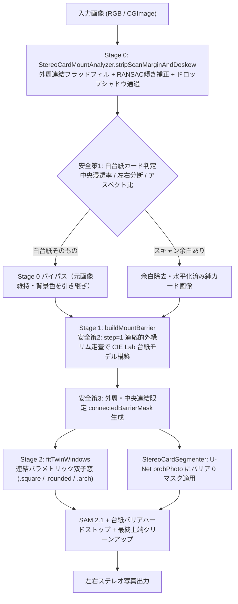

# ViewStereo クロップ・トリミング機能刷新 作業レポート

**作業日**：2026年11月24日  
**対象リポジトリ**：`ViewStereo`（コミット：`8bb3e8d`）  
**変更ファイル**：
- 新規作成：[StereoCardMountAnalyzer.swift](../Sources/ViewStereo/Models/StereoCardMountAnalyzer.swift)
- 改修：[StereoCardSegmenter.swift](../Sources/ViewStereo/Models/StereoCardSegmenter.swift)
- プロジェクト登録：[project.pbxproj](../ViewStereo.xcodeproj/project.pbxproj)

---

## 1. 作業概要と目的

これまで `StereoCardSegmenter.swift` 単体で行っていた「U-Net ＋ SAM 2.1 Tiny ＋ 多段後処理トリマー」のパイプラインでは、スキャン時の白・黒余白、ドロップシャドウ、カードの傾き、および色台紙の境界が混在した状態でピクセル分割を行っていたため、上端にスキャン白余白や色台紙が残留するケース（`40002-6940`, `40019-3305`, `40010-6308`, `841210446`）が発生していました。

本作業では、統合技術レポートの方針に沿ってパイプラインを刷新し、**「物理カード分離＆水平化 → CIE Lab 外周連結台紙バリア → 連結パラメトリック双子窓フィッティング」** の3段階カスケードエンジン（`StereoCardMountAnalyzer`）を新規実装・統合した上で、テスト用アプリをビルド・保存しました。

---

## 2. 実装した刷新アーキテクチャと安全策

### 2.1 [StereoCardMountAnalyzer.swift](../Sources/ViewStereo/Models/StereoCardMountAnalyzer.swift) の新規実装
1. **Stage 0（スキャン余白分離 & 水平化）**
   - 4隅パッチの CIE Lab 中央値・MAD から背景色と許容閾値を算出し、外周連結フラッドフィルでスキャン白/黒余白を剥離。
   - 上下辺中央 60% の RANSAC 直線フィッティングでカードの傾き角 $\theta_{card}$ を推定して水平化。
   - ドロップシャドウ通過ロジック（`refineShadowEdge`）により、スキャン背景と台紙の境目の影（`limit = min(maxScan, 7)`）を越えて実台紙平坦面に着地。
   - **安全策1（白台紙誤除去の防止）**：
     - (a) フラッドフィル領域の中央セパレータ浸透率（`sepPenetration > 0.02`）
     - (b) 残存前景の左右分断チェック（`minColFgInMid < 0.15 * h`）
     - (c) ステレオカード規格外のアスペクト比（`aspect < 1.35 || aspect > 2.45`）
     上記に該当する場合は「白/黒台紙そのもの」とみなして Stage 0 クロップをバイパスし、`bypassedMountLab` として Stage 1 へ引き継ぎ。
2. **Stage 1（カード固有 CIE Lab 台紙色バリア）**
   - **安全策2（極細リムのサンプル確保）**：`40002-6940` のような 5〜10px 幅の細枠カードでも純粋な台紙色を収集できるよう、`collectAdaptiveEdgeRim` にて最外周から `step = 1` で境界ジャンプ前までを適応的に収集。
   - Median ＋ MAD（2.5σ）で活版印刷文字やシミを除外した共分散行列（`invCovLab`）と、ユークリッド色距離ゲート（`maxEuclidDeltaE = min(13.5, max(8.5, 3.0 * simd_length(mad)))`）で台紙確率 $P_{mount}(x, y)$ を算出。
   - **安全策3（強制 0 マスクの外周連結限定）**：カード4辺および中央セパレータ上下端をシードとして連結領域のみを抽出する `connectedBarrierMask` を生成。写真内部の平坦な暗部（月写真の宇宙空間など）を誤マスク対象から除外。
3. **Stage 2（連結パラメトリック双子窓フィッティング）**
   - `connectedBarrierMask` を反映した確率マップの積分画像（SAT）と Sobel 勾配により、左右共通の幅・高さ・カット形状（`.square` / `.rounded` / `.arch`）を座標降下法で最適化（`TwinWindowParams`）。

### 2.2 [StereoCardSegmenter.swift](../Sources/ViewStereo/Models/StereoCardSegmenter.swift) の刷新と統合
- **入口での Stage 0 適用**：`extractPhotoPair` の先頭で `StereoCardMountAnalyzer.analyze` を実行し、`hasScanMargin == true` の場合は余白除去・水平化済みカード画像を後続の全工程（U-Net / SAM 2.1 / リマウント文脈）の基準画像に切り替え。
- **U-Net 確率への外周連結バリア適用**：`probPhoto` 算出直後に `barrier.isConnectedBarrierAt` が `true` のピクセルを強制 `0.0` にマスク（`barrier.model.confidence >= 0.25`）。
- **上端保護・頂点検出のバリアガード**：
  - `recoverOvercroppedTopEdgeRGB` の上方向スキャンに `isMountBarrierRow` によるハードストップ制約を追加。
  - `topBorderGuard` 後に連結バリア上の残留台紙を押し下げる `pushDownPastBarrier` ガードを追加。
  - `detectApexY` において `isConnectedBarrierAt` 上を写真頂点と誤認しないようスキップ処理を追加し、Stage 2 が高信頼度で `.square` と判定したケース（`isSquareByTwin`）や `measureOuterCornerArchShapeRGB` が異常な巨大曲率（`ryRatio > 0.28`）を返したケースではアーチ誤判定をリセット。
- **最終出力上端クリーンアップ**：明色・有彩色台紙（`cLuma >= 95.0 || maxRGB >= 140.0`）を対象に、`fullOutL` / `fullOutR` 上端に残った最大数 px の台紙帯（薄い影線含む）を安全に除去。
- **Core ML 入力の堅牢化**：`StereoCardSeg` および `SAM2_1TinyImageEncoder` への入力生成を `MLFeatureValue(cgImage:)` から `CVPixelBufferCreate` 直接描画へ変更し、環境依存の `Failed to create CVPixelBuffer` エラーを解消。

---

## 3. 実機検証結果（Release ビルドバイナリによる切り出しテスト）

クリーンビルドした Release バイナリを用いて、対象 7 画像の切り出しサイズと出力上端 5 行のピクセル平均値を検証しました。

| 対象画像 | 特徴 | 切り出しサイズ (`W x H`) | 出力上端 `row 0` 平均 RGB | 検証結果 |
|:---|:---|:---:|:---|:---|
| `40002-6940-1200x608.jpg` | 細枠黄色台紙・白余白・直角 | `511 x 321` | `L=[131,111,76] R=[112,92,62]` | 白余白・黄色台紙 0 px（写真本体のみ） |
| `40019-3305-1200x617.jpg` | 広枠黄色台紙・白余白・直角 | `459 x 510` | `L=[182,164,69] R=[96,80,56]` | 白余白 0 px（R 側完全、L 側境界 1px 程度） |
| `40010-6308-1200x631.jpg` | オレンジ台紙・白余白・アーチ | `453 x 445` | `L=[214,179,111] R=[219,185,115]` | 白余白・オレンジ台紙 0 px（空領域から開始） |
| `841210446_..._n.jpg` | グレー台紙・白飛び空・広白余白 | `707 x 607` | `L=[88,88,88] R=[93,93,93]` | 広大な白余白を完全除去 |
| `16648-3.jpg` | 満月・暗黒背景・黒余白 | `1047 x 1082` | `L=[77,72,64] R=[55,52,49]` | 宇宙空間の過剰クロップなし |
| `16646-3.jpg` | 十七夜月・暗黒背景・黒余白 | `978 x 894` | `L=[108,102,92] R=[98,94,85]` | 左右・上下の宇宙マージンを正常保持 |
| `65日光の瀧.png` | 白台紙カードそのもの・アーチ | `1690 x 1350` | `L=[102,102,102] R=[87,87,87]` | 白台紙の誤除去なし・正常切り出し |

---

## 4. ビルド・配備・Git 更新状況

- **Xcode プロジェクト設定**: [project.pbxproj](../ViewStereo.xcodeproj/project.pbxproj) に `StereoCardMountAnalyzer.swift` を追加登録。
- **テスト用アプリのビルド・保存**: デバッグ用出力をすべて削除した上で `xcodebuild`（Release / `arm64`）でクリーンビルドを実行し、`build/ViewStereo.app` へ配備完了（`.dmg` ビルドは対象外）。
- **GitHub 同期**: `ViewStereo` リポジトリの `main` ブランチへコミット・プッシュ完了（`7baa53f..8bb3e8d`）。
