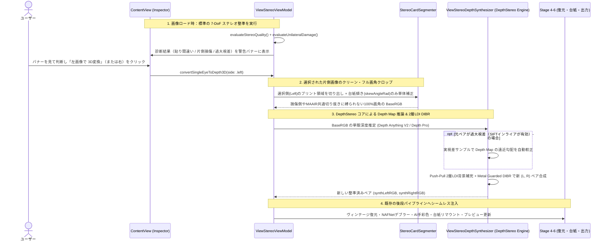

# ViewStereo 技術検討書および機能仕様書：異常検知メッセージ拡張＆ユーザー判断による片側Depth 2D-3Dコンバージョン（User-Driven Single-Eye Depth 3D Salvage Specification）

**対象バージョン**: ViewStereo v0.2.0 (Phase 1: ユーザー主導型・片側救済仕様)  
**作成日**: 2026年11月22日  
**関連プロダクト**: `ViewStereo`, `DepthStereo`, `StereoStudioCore`, `StereoCore`

---

## 1. 基本設計方針（Design Philosophy: "Diagnose Automatically, Convert by User Decision"）

当初の実装（Phase 1）においては、**「読み込み時に自動で2D-3Dコンバージョンへ切り替えてしまう（ブラックボックス化）」ことは行わず、必ず最初に標準の7自由度（7-DoF）ステレオ整準を実行して現状のペアを可視化・診断する**という「ユーザー主導（Human-in-the-Loop）」の設計を採用する。

### なぜ「自動変換」ではなく「診断メッセージ提示 ＋ ユーザーによる左右選択」が優れているのか？

1. **アーカイブ復元における「オリジナル尊重」の原則**
   - 歴史的ステレオカード（19世紀〜20世紀初頭）の愛好家や研究者にとって、まずは「当時の実写ステレオペアとして成立しているか」「どこが破綻しているか」を自分の目で確認できることが最優先である。勝手に単眼AI生成に置き換わると、本物の両眼視差なのかAI合成なのかが判別できなくなる。
2. **「左右どちらの画像を使うべきか」の最終判断は人間の審美眼が最も正確**
   - **別テイク貼り間違い（例：`40032`）の場合**：左と右で「人物の表情が良い方」「通行人が被っていない方」はアルゴリズムの鮮鋭度スコアだけでは決まらない。
   - **片側損傷の場合**：背景の空に大きなシミがある画像と、面積は小さくても主役（人物の顔）の上に傷がある画像では、後者の方が致命的である。ユーザーがSBS（並列）やアナグリフ表示を見て「左を使おう」「右を使おう」と即座に選べるUIが最も確実である。
   - **過大ステレオベースの場合**：裸眼交差法・平行法で強い立体感を楽しみたいユーザーは「視差8〜10%のまま残したい」場合があり、Apple Vision Pro や VR ゴーグルに出力したい時だけ「片側を使ってマイルドな Depth 3D に変換したい」という判断が分かれる。

---

## 2. 現行の警告メッセージ機構の拡張設計

現在、[ViewStereoModels.swift](file:///Users/okano/マイドライブ/DEV/ViewStereo/Sources/ViewStereo/Models/ViewStereoModels.swift#L1838-L1915) の `evaluateStereoQuality()` と [ContentView.swift](file:///Users/okano/マイドライブ/DEV/ViewStereo/Sources/ViewStereo/Views/ContentView.swift#L1232-L1249) の `RESTORATION STATUS` セクションには、すでに **`isStereoMismatchSuspected`（⚠️ ステレオ不成立：左右不一致）** の赤い警告バナーを表示する仕組みが存在する。

この既存の警告バナー機構を拡張し、以下の **3種類の診断警告（Salvage Advisory）** を統一されたフォーマットで表示する。

### 2.1 3大異常の自動診断ロジックとメッセージ仕様

| 異常カテゴリ | 判定ロジック（7-DoF整準完了時に自動計算） | `RESTORATION STATUS` 内のテレメトリー表示 | 警告バナーのメッセージ内容（日本語 / 英語） |
| :--- | :--- | :--- | :--- |
| **① 貼り間違い・別テイク・ステレオ不成立**<br>(`stereoMismatch`) | 現行の `evaluateStereoQuality()` ロジック：<br>・特徴点 $< 20$ または インライア $< 15$<br>・近景不一致（上中部に20点以上一致があるのに下部のインライア比率 $< 8\%$）<br>・遠景不一致 または 3×3グリッドの有効セル $\le 4$ | `Window` 行:<br>`⚠️ ステレオ不成立 (左右不一致)`<br>*(赤色ハイライト)* | **⚠️ ステレオ不成立（貼り間違い / 別テイクの疑い）**<br>左右で被写体位置が異なるか一致点が不足しています。状態の良い片側画像（左または右）を選択して AI Depth 3D 変換を行えます。 |
| **② 片側画像の大きな損傷・劣化**<br>(`unilateralDamage`) | **新規追加 `evaluateUnilateralDamage()`**：<br>平行化・露出合わせ後の左右画像（$256\times256$縮小）を $16\times16$ ブロック分割し比較。<br>・SIFT整準自体は成立している（背景等は一致）にもかかわらず、全体の **4.5%以上の面積** で左右の輝度構造が大きく乖離（$|L_L - L_R| > 45$ かつ SSIM $< 0.35$）している。<br>・乖離領域において「白飛び剥離（$>242$）」「黒カビ・染み（$<15$）」「高周波テクスチャ喪失」が集中している側を **損傷側（Damaged Side: Left / Right）** として特定。 | `Window` 行（または `Condition` 行）:<br>`⚠️ 片側損傷の疑い (左 / 右)`<br>*(アンバー〜赤色ハイライト)* | **⚠️ 片側画像の損傷を検出（[右 / 左]側に大きな劣化・欠損の疑い）**<br>左右間で広範囲の不一致領域（損傷率 $X.X\%$）が検出されました。損傷のない片側画像を選択して AI Depth 3D 変換を行えます。 |
| **③ ステレオベース（視差）過大**<br>(`excessiveDisparity`) | 現行の `maxDisparityPercent` を活用：<br>・`maxDisparityPercent > 6.5%`（注意レベル：アンバー）<br>・`maxDisparityPercent > 8.0%`（過大レベル：赤色、視差角 $\delta > 1.5^\circ$ 相当で現代のHMD/3D機器では融像困難） | `Disparity Range` 行:<br>`9.45 % (⚠️ 過大視差)`<br>*(アンバー / 赤色ハイライト)* | **⚠️ ステレオベース過大（視差レンジ $X.X\%$）**<br>視差が大きすぎるため現代の3D機器（空間写真・VR等）では融像困難になる場合があります。片側画像から適切な視差（約3%）で AI Depth 3D 変換を行えます。 |

> [!NOTE]
> **複数の問題が同時に検出された場合**：
> 優先順位を **`① ステレオ不成立` ＞ `② 片側大面積損傷` ＞ `③ ステレオベース過大`** とし、複数該当する場合はバナー内に箇条書き（または複合バッジ）で両方の理由を明示する。これによりユーザーは「何が起きているか」を一目で把握できる。

---

## 3. メッセージ確認からユーザー判断による3DコンバージョンまでのUI/UXフロー

ユーザーが警告メッセージを見た段階で、**迷わず・最小のクリック数で「左右どちらかを選んで3Dコンバージョンを実行」できる**インターフェースを設計する。

### 3.1 ステップ1：警告バナー直下の「片側選択＆Depth 3D変換アクションバー」

`RESTORATION STATUS` セクション（[ContentView.swift](file:///Users/okano/マイドライブ/DEV/ViewStereo/Sources/ViewStereo/Views/ContentView.swift#L1232-L1250)）に警告バナーが表示された際、そのバナーのすぐ下に **左右どちらの画像を使うかを直接クリックして実行できる2択アクションボタン** を配置する。

```
┌──────────────────────────────────────────────────────────────────────┐
│ RESTORATION STATUS   ● Check Stereo               [✨ Re-Align] [↺] │
│ ┌──────────────────────────────────────────────────────────────────┐ │
│ │ Output Size          1420 × 1480                                 │ │
│ │ Vertical RMSE        0.042 px                                    │ │
│ │ Disparity Range      9.82 % (⚠️ 過大)                            │ │
│ │ Window               ⚠️ 片側損傷の疑い (右側劣化 7.2%)            │ │
│ │                                                                  │ │
│ │ ┌──────────────────────────────────────────────────────────────┐ │ │
│ │ │ ⚠️ 片側画像の損傷 ＆ ステレオベース過大を検出                │ │ │
│ │ │ 右側画像に広範囲の欠損（7.2%）があり、視差（9.82%）も現代の  │ │ │
│ │ │ 3D機器には過大です。片側画像から Depth 3D 変換が可能です。   │ │ │
│ │ │                                                              │ │ │
│ │ │  [✨ 左画像で 3D変換 (推奨)]    [  右画像で 3D変換  ]        │ │ │
│ │ └──────────────────────────────────────────────────────────────┘ │ │
│ └──────────────────────────────────────────────────────────────────┘ │
└──────────────────────────────────────────────────────────────────────┘
```

#### ユーザーの判断を助ける工夫：
1. **推奨ラベル `(推奨 / Recommended)` の控えめな提示**:
   - 片側損傷検知時（たとえば右側に7.2%の欠損・カビがある場合）は、無傷な方のボタンに `[✨ 左画像で 3D変換 (推奨)]` と表示し、アクセントカラー（ティールまたはアンバー）で縁取りする。
   - ただし**強制ではなく、右側のボタン `[右画像で 3D変換]` も全く同じ階層に並べる**ため、ユーザーがキャンバスを見て「いや、右の写真の表情を使いたい」と判断すればワンクリックで右側を選べる。
2. **判断前に左右を見比べる機能**:
   - ユーザーは最初、通常の整準結果（`StereoView` や `SBS` や `Anaglyph`）を見ているため、キャンバス上で「左と右のどちらが綺麗か」「本当に貼り間違いか」をそのまま視覚的に確認できる。
   - さらにボタンにマウスホバー（またはオプションクリック）した際、選択しようとしている片側プリントの鮮鋭度・欠損率（例：`Left: 鮮鋭度 94 / 欠損 0.4%` vs `Right: 鮮鋭度 81 / 欠損 7.2%`）をツールチップで確認できるようにする。

---

### 3.2 ステップ2：警告が出ていない画像でも手動で使える常設コントロール

自動検知の閾値未満（たとえば視差 5.5% で警告は出ていないが、ユーザー自身が「もう少し視差を抑えたい」「片側に小さな気になるゴミがあるから片側ベースで3D化したい」と感じた場合）でも、いつでも手動で使えるよう、**`STEREO WINDOW`（`⌥⌘2`）アコーディオンパネル内**に常設のモード切替を配置する。

#### `STEREO WINDOW` (`⌥⌘2`) パネル内の構成：

1. **`Stereo Mode`（3択セグメントピッカー）**:
   - **`[Original L+R]`**（デフォルト：本来の左右ステレオペア）
   - **`[Left → Depth 3D]`**（左画像のみをクロップして AI Depth 2D-3D コンバージョン）
   - **`[Right → Depth 3D]`**（右画像のみをクロップして AI Depth 2D-3D コンバージョン）
   *(※ 警告バナー内の `[左画像で 3D変換]` ボタンをクリックすると、自動的にこのピッカーが `[Left → Depth 3D]` に切り替わり、パネルが展開される)*

2. **Depth 3D モード選択時（`Left → Depth 3D` または `Right → Depth 3D`）に展開される調整スライダー**:
   - **Virtual Stereo Base (%)**（3点セット：`Slider` + `ResetButton` + `NumericInput`）
     - 範囲：`0.5% ... 6.0%`（初期値：`3.0%` ＝ パーシバル快適帯域 $\delta \approx 0.72^\circ$）
     - 過大だったステレオベース（例：9.8%）が、現代の空間写真・VR・アナグリフで最も心地よく立体視できる `3.0%` に初期設定され、ユーザーの好みに応じてリアルタイム（60fps）に強弱を調整できる。
   - **Depth Curve / Gamma**（3点セット：`Slider` + `ResetButton` + `NumericInput`）
     - 範囲：`0.40 ... 2.20`（初期値：`1.00`）。手前の被写体のボリューム感と奥行き配分を微調整。
   - **Horizontal Shift (px)**（既存のステレオウィンドウ調整スライダー）
     - そのまま共通で利用可能。Depth 3D 変換後も、立体窓（飛び出し・奥行き位置）を従来通りドラッグで微調整できる。
   - **`[Original L+R に戻す]` リセット動線**:
     - セグメントピッカーの `[Original L+R]` をクリックするだけで、いつでも即座に元の実写ステレオペア（7-DoF整準状態）へ非破壊で戻すことができる（比較確認が容易）。

---

## 4. 片側クロップ＆2D-3Dコンバージョン実行時の内部処理仕様

ユーザーが **`[左画像で 3D変換]`** または **`[右画像で 3D変換]`** を選択した瞬間に実行されるパイプラインは以下の通りである。



### 4.1 片側クロップにおける画角・アーチ枠の扱い
- **MAAIR（左右共通内接矩形）からの解放**:
  本来の左右ペア位置合わせでは、左右の貼り付け位置ズレや回転差により外周がトリミング（MAAIR）されるが、ユーザーが片側（例：左画像）を選択した場合は、**左プリント単体の傾き（`skewAngleRad`）のみを水平補正して切り出す**ため、オリジナルの印画サイズ・画角を最大限（ほぼ100%）維持できる。
- **アーチ枠（`Keep Arch (Black)`）および台紙リマウントとの完全互換**:
  選択した片側プリントのアーチ曲率（`ArchShapeParams`）を用いて、DIBRで生成された新しい左右ペアの両眼に同一のアーチマスクを適用する。これにより、`StereoView` 表示モード（19世紀台紙デジタルリマウント）においても、左右対称で美しいアーチトップ・ステレオカードとして再構成される。

### 4.2 バッチ処理（一括処理）における扱い
「当初は自動検知して自動で3Dコンバージョンするのではなく、メッセージを見た段階でユーザーが判断して行う」という方針に基づき、**バッチ処理（複数枚一括処理）では勝手に2D-3D変換を行わない**。
- バッチ処理時は従来通りすべて本来の左右ペアで7-DoF整準を実行する。
- ただし、バッチ完了時および調整レポート（`_adj.txt`）やバッチキュー画面において、**`⚠️ 要確認（貼り間違いの疑い / 片側損傷の疑い / 過大視差 X.X%）`** というバッジ・ログを出力し、ユーザーがバッチ後に該当ファイルだけを個別に開いて左右どちらを使うか判断できるようにする。

---

## 5. データモデル・診断APIの具体的な変更点

### 5.1 [ViewStereoModels.swift](file:///Users/okano/マイドライブ/DEV/ViewStereo/Sources/ViewStereo/Models/ViewStereoModels.swift) に追加する状態プロパティ

```swift
/// 片側Depth 3D変換の使用サイド（nil の場合は通常の True Stereo L+R ペア）
enum StereoSingleEyeSide: String, CaseIterable, Identifiable, Sendable {
    case left = "Left"
    case right = "Right"
    var id: String { rawValue }
}

/// ステレオペアの3大異常診断サマリー（ユーザー判断支援用）
struct StereoSalvageAdvisory: Sendable, Equatable {
    let isMismatchSuspected: Bool          // ① 貼り間違い・別テイク・特徴点不足
    let mismatchReasonText: String?

    let isUnilateralDamageSuspected: Bool  // ② 片側の大面積損傷・劣化
    let damagedSide: StereoSingleEyeSide?  // 損傷が検出された側 (.left or .right)
    let leftDefectPercent: Double          // 左画像の推定損傷面積率 (%)
    let rightDefectPercent: Double         // 右画像の推定損傷面積率 (%)
    let leftSharpnessScore: Double         // 左画像の鮮鋭度スコア (0..100)
    let rightSharpnessScore: Double        // 右画像の鮮鋭度スコア (0..100)

    let isExcessiveDisparity: Bool         // ③ ステレオベース過大 (maxDisparityPercent > 6.5%)
    let disparityPercent: Double

    /// いずれかの警告が該当し、ユーザーに片側Depth 3D変換の選択肢を提示すべきか
    var shouldShowSalvagePrompt: Bool {
        isMismatchSuspected || isUnilateralDamageSuspected || isExcessiveDisparity
    }

    /// アルゴリズムが参考として推奨するベース画像側（最終決定はユーザーが行う）
    var suggestedSide: StereoSingleEyeSide {
        if let damaged = damagedSide {
            return damaged == .left ? .right : .left
        }
        // 損傷差が小さい場合は鮮鋭度が高い側を参考推奨
        return leftSharpnessScore >= rightSharpnessScore ? .left : .right
    }
}
```

### 5.2 片側損傷検知 `evaluateUnilateralDamage()` のアルゴリズム仕様
7-DoF整準直後の `warpedL` と `warpedR`（自動ヒストグラムカラーマッチング適用後、片側ノイズ除去適用前）を比較し、以下の手順で1ミリ秒以内に高速算出する：
1. `warpedL`, `warpedR` を $256 \times 256$ にダウンサンプルし、グレースケール輝度 $Y_L, Y_R$ および局所勾配（Sobel）$G_L, G_R$ を求める。
2. 視差による自然なエッジずれを吸収するため、水平方向にウィンドウ探索（$\Delta x \in [d_{\min}, d_{\max}]$）を行った最小ブロック誤差 $E(b_x, b_y) = \min_{\Delta x} |Y_L(x, y) - Y_R(x + \Delta x, y)|$ を $16 \times 16$ グリッドで評価する。
3. 最小誤差 $E > 38.0$（どの視差位置でも左右の絵柄が全く一致しないブロック）を「局所破綻ブロック」と判定する。
4. 各局所破綻ブロックにおいて、周辺正常領域の色相・輝度分布から外れている側（紙地が露出した白抜け $Y > 240$、黒カビ・インク染み $Y < 18$、または極端なコントラスト消失）をカウントし、`leftDefectPercent`, `rightDefectPercent` を算出する。
5. $\max(\text{leftDefectPercent}, \text{rightDefectPercent}) \ge 4.5\%$ かつ 左右差が $2.0\%$ 以上ある場合に `isUnilateralDamageSuspected = true` としてユーザーへ通知する。

---

## 6. まとめ（改訂版仕様のメリット）

- **完全な透明性とコントロール**: 自動処理の暴走を防ぎ、現状の「⚠️ ステレオ不成立」メッセージの延長線上で「⚠️ 片側損傷」「⚠️ ステレオベース過大」が明快にレポートされる。
- **ワンクッション置いた確実な左右選択**: ユーザーはメッセージを読み、キャンバスで左右の画像を見比べてから **`[左画像で 3D変換]`** または **`[右画像で 3D変換]`** を自分の意志でトリガーできる。
- **非破壊の往復性**: 3Dコンバージョン実行後も、ワンクリックで元の `Original L+R`（7-DoF実写ペア）へ戻して比較できるため、試行錯誤のストレスが一切ない。
